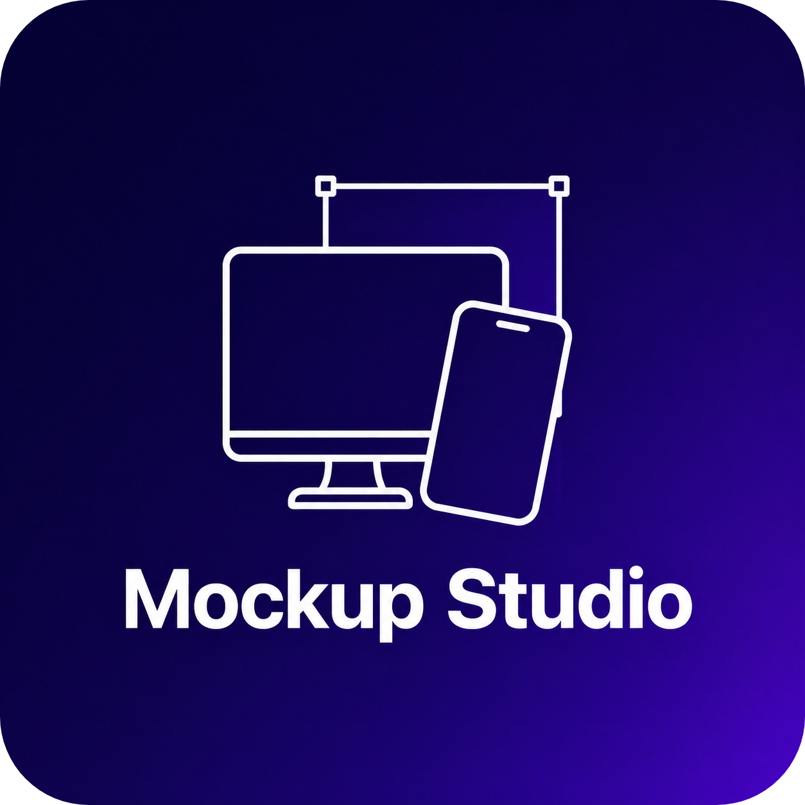

#  Mockup Studio

Desktop device mockup scene builder. Compose beautiful device mockups with drag-and-drop, multi-scene support, and instant export.

## Origin Story

Mockup Studio started as a single HTML file — `mockup-template.html` — a quick static mockup generator for showcasing device screens. As features piled on (text editing, backgrounds, layer management), it grew into a full React + Vite project. But the scope had outgrown a web app: native file handling, true drag-and-drop, performance at scale, and desktop packaging all demanded more. That's when Mockup Studio was reborn as a proper Electron desktop application with a real architecture — Zustand state management, IPC-based file I/O, and a component system designed to scale.

> The original web app (React + Tailwind) is preserved in the [`legacy`](https://github.com/Omar-Khaled-57/mock-up-studio/tree/legacy) branch.

## Features

- **7 Device Types** — Monitor, Laptop, iPad, Phone, Watch, Browser, Terminal
- **Drag & Resize** — 60fps pointer-event-based dragging with direct DOM mutation
- **Smart Snapping** — Snap to element edges, canvas center, grid, and guides
- **Text Editing** — Inline editing with gradient, glow, shadow, and multiple font weights
- **Image Overlays** — Upload, position, and style images with effects (opacity, blur, glow, shadow, blend modes, flip)
- **Shape System** — 11 SVG shape kinds with fill, gradient, shadow, glow, and background image
- **Background Presets** — 7 built-in backgrounds (Aurora, Neon Grid, Blue Cyber, etc.)
- **Themes Panel** — Solid, gradient, and preset background controls; 17 color theme presets
- **Multi-Scene** — Multiple scenes per project with tab navigation, drag-to-reorder, pinning
- **Version History** — Auto-snapshots every 5 minutes with manual save/restore
- **Layer Management** — Z-order reordering, visibility toggle, lock, inline rename, drag reorder, groups
- **Alignment Tools** — Align selected elements (left, center, right, top, middle, bottom)
- **Dark / Light UI** — Toggle between dark and light interface themes
- **Export Engine** — PNG, JPEG, WebP at 1x–4x scale with solid/transparent/custom backgrounds
- **Multi-Scene Export** — Export all scenes as a ZIP archive with one click
- **Project Files** — `.mockup` ZIP format with JSON manifest + embedded assets
- **Auto-Save Recovery** — Crash recovery with periodic snapshots
- **File Association** — Double-click `.mockup` files to open them directly
- **Unsaved Changes Guard** — Prompts before closing with unsaved work
- **Keyboard Shortcuts** — Full shortcut suite with reference modal (Ctrl+/)
- **Watermark** — Optional text watermark excluded from exports
- **Color Extraction** — Extract dominant colors from device screens
- **Layout Templates** — Pre-composed layouts for quick scene setup
- **Auto-Update** — GitHub Releases integration (production builds)

## Tech Stack

| Layer | Technology |
|-------|-----------|
| Desktop Shell | Electron 33 |
| Bundler | electron-vite 2 (Vite 5) |
| UI Framework | React 18 + TypeScript 5.6 |
| Styling | Tailwind CSS 3.4 |
| State Management | Zustand 5 (10 slices) |
| Export | modern-screenshot 4 |
| Archive | JSZip 3 |
| Icons | Lucide React |
| Testing | Vitest + jsdom |
| Packaging | electron-builder 25 |

## Getting Started

### Prerequisites

- Node.js 18+
- npm 9+

### Install

```bash
npm install
```

### Development

```bash
npm run dev
```

### Build

```bash
# Windows (NSIS installer + portable)
npm run package

# macOS (DMG)
npm run package:mac

# Linux (AppImage)
npm run package:linux
```

Output is written to `release/`.

### Testing

```bash
npm test              # single run
npm run test:watch    # watch mode
```

### Linting

```bash
npm run lint
npm run typecheck
```

## Project Structure

```
src/
  main/                    Electron main process
    index.ts               Window creation, lifecycle, file association, close guard
    menu.ts                Native Electron menu
    ipc-handlers.ts        IPC handlers (save, open, recovery)
    file-system.ts         Recovery, recent projects, ZIP I/O
    auto-updater.ts        GitHub Releases auto-update (6h interval)
  preload/
    index.ts               contextBridge API
  shared/
    types.ts               Core interfaces (Scene, Device, TextBox, etc.)
  renderer/
    App.tsx                Root layout, keyboard shortcuts, close guard, file association
    store/                 Zustand (11 slices merged)
    hooks/                 useDrag, useResize, useSnapping, useKeyboardShortcuts, useDebouncedHistory, useTheme
    lib/                   constants, device-utils, export-engine, color-extraction, project-serialization
    components/
      canvas/              Viewport, Scene renderer, Grid, Guides, WatermarkOverlay
      devices/             DeviceFrame, Monitor, Laptop, Phone, iPad, Watch, Browser, Terminal
      text/                InlineEditor, TitleBlock, TextBox
      images/              ImageOverlay
      backgrounds/         7 background presets + Solid/Gradient
      sidebar/             Sidebar, 11 panels, SceneTabs, ExportDialog, LayoutTemplates
      shared/              ResizeHandles, ContextMenu, ShortcutsModal, ErrorBoundary
      splash/              SplashScreen
```

## Architecture

### State Management

The Zustand store is composed of 11 slices merged into a single state object:

| Slice | Responsibility |
|-------|---------------|
| `projectSlice` | File path, dirty state, save/open/new |
| `sceneSlice` | Scene CRUD, z-order, grid/guides, `safeScene()` |
| `shapeSlice` | Shape CRUD (independent from sceneSlice) |
| `selectionSlice` | Multi-select, select-all, alignment |
| `historySlice` | Undo/redo (JSON snapshots, 500 max) |
| `viewportSlice` | Zoom, pan, fit-to-window |
| `uiSlice` | Sidebar tab, theme, splash state |
| `exportSlice` | Export format, scale, quality |
| `clipboardSlice` | Internal copy/cut/paste |
| `versionHistorySlice` | Auto-snapshots (5min interval, 50 max) |
| `watermarkSlice` | Watermark text and visibility |

### Key Patterns

- **Drag performance**: Direct DOM mutation during drag, store commit on pointerup
- **Resize**: Window-level pointermove/pointerup listeners (not pointer capture)
- **History**: JSON serialization snapshots with debounced push for continuous inputs
- **Scene safety**: `safeScene()` selector prevents out-of-bounds access everywhere
- **Theme**: CSS variables on `body.light-theme` class; canvas/devices stay dark always
- **Close guard**: IPC-based unsaved-changes prompt with 3s safety timeout
- **File association**: Handles macOS `open-file`, Windows/Linux `second-instance`, and `process.argv`

## File Format

`.mockup` files are ZIP archives containing:

```
manifest.json          Project metadata + scene data
assets/                Device screens, images, thumbnails (base64 in manifest)
```

## Testing

231 tests across 14 files covering all store slices, utility functions, export logic, shape system, and device interactions.

## License

MIT
