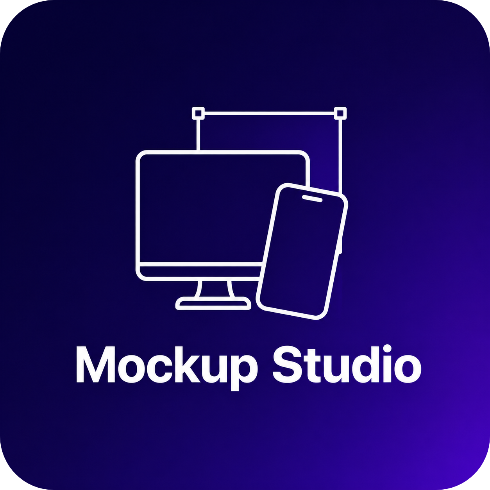

#  Mockup Studio

Desktop device mockup scene builder for composing device screenshots, text, images, shapes, and masks into exportable scenes.

## Origin Story

Mockup Studio started as a single HTML file — `mockup-template.html` — a quick static mockup generator for showcasing device screens. As features piled on (text editing, backgrounds, layer management), it grew into a full React + Vite project. But the scope had outgrown a web app: native file handling, true drag-and-drop, performance at scale, and desktop packaging all demanded more. That's when Mockup Studio was reborn as a proper Electron desktop application with a real architecture — Zustand state management, IPC-based file I/O, and a component system designed to scale.

> The original web app (React + Tailwind) is preserved in the [`legacy`](https://github.com/Omar-Khaled-57/mock-up-studio/tree/legacy) branch.

## Features

### Core Editing
- **7 Device Types** — Monitor, Laptop, iPad, Phone, Watch, Browser, Terminal
- **Drag & Resize** — 60fps pointer-event-based dragging with direct DOM mutation, Shift-proportional scaling
- **Tool System** — Bottom toolbar with Select, Brush, Eraser, Focus, and Mask tool groups; single-key shortcuts (V/H/M/X/B/E/G)
- **Smart Snapping** — Snap to element edges, canvas center, grid, and guides; independent smart-guide and grid-snap toggles
- **Text Editing** — Inline editing with inline editor (gradient, glow, shadow, stroke, letter/word spacing, text-transform, line height)
- **Image Overlays** — Upload, position, and style images; opacity, border-radius, blend modes (12), flip X/Y, blur, glow, shadow, per-element effects

### Shape System
- **13 SVG shape kinds** — Rectangle, circle, ellipse, triangle, star, hexagon, diamond, parallelogram, trapezoid, cross, plus, heart, arrow-right
- Shape fill, opacity, rotation, blur, blend mode, corner radius
- Shape background image (SVG pattern fill)
- Shape-specific thickness controls (cross, plus, arrow)

### Masking
- **First-class masks** — reusable clip geometry on any element or the whole canvas
- **Mask / Unmask modes** — draw to hide (punch) or draw to restore (reveal)
- Additive masking (stacked strokes) with subtractive unmask via polygon boolean difference
- Mask brush, rectangle, and ellipse shapes
- Frozen mask snapshots (opt-in whole-scene capture)
- Transparent canvas with black + blue checkerboard visualization

### Image Editing Tools
- **Paint Brush** — freehand strokes committed as per-stroke raster layers
- **Blur Brush** — brush and region tools (rect, ellipse, line) for selective blur
- **Eraser** — destination-out erase to transparent
- **Magic Eraser** — tolerance-based flood-fill erase
- **Per-element effects** — 9 non-destructive adjustments (brightness, contrast, exposure, saturation, hue, gamma, temperature, tint, blur)

### Selection & Layers
- **Focus mode** — group-scoped editing with dimming scrim and highlight ring
- **Container clips** — grouped elements render clipped to their container's shape
- **Drag-to-nest** — drag elements onto containers to parent them; empty-canvas drop un-nests
- **Aspect ratio lock** — per-element toggle, preserves shape without holding Shift
- **Multi-scene** — Multiple scenes per project with tab navigation, drag-to-reorder, pinning
- **Layer management** — Z-order reordering, visibility/lock toggles, inline rename, groups, nested groups
- **Alignment & distribution** — 6-direction align, 4-direction distribute (space and center)
- **Copy / Paste Style** — transfer appearance properties between same-kind elements
- **Reusable Units** — save canvas elements as reusable definitions with type-tag grouping, search, drag-and-drop placement, and definition editing with live instance sync

### Canvas & Viewport
- **Canvas chrome bar** — scene tabs, zoom controls (in/out/reset/fit), View menu
- **Canvas rotation** — Rotate 90° button
- **Rulers** — zoom/pan-aware tick marks, drag to create guides
- **Interactive guides** — drag to reposition, right-click to delete
- **Grid** — configurable size, color, opacity, snap
- **Transparent canvas** — toggle in Themes panel; real alpha in exports

### Backgrounds & Themes
- **7 built-in backgrounds** — Aurora, Neon Grid, Blue Cyber, QPreset, Qless, Storybox 3, Dark Solid
- **Background editor** — Solid, gradient (linear/radial), image, and preset types
- **17 color theme presets** — instant one-click scene color schemes
- **Dark / Light UI** — interface theme toggle (canvas stays dark)

### Export & Projects
- **Export modal** — PNG, JPEG, WebP at 1x–4x scale with solid/transparent/custom backgrounds
- **Multi-scene export** — Export all scenes as a ZIP archive
- **Project files** — `.mockup` ZIP format with JSON manifest + embedded assets
- **Version history** — Time-gated auto-snapshots (5-minute interval, 50 max; no pinned-scene gate)
- **Auto-save recovery** — Crash recovery with periodic snapshots
- **File association** — Double-click `.mockup` files to open them directly
- **Unsaved changes guard** — Prompts before closing with unsaved work
- **Auto-update** — GitHub Releases integration (production builds) with styled in-app prompts (checking / available / up-to-date / failed), a 25s network-timeout guard, and download progress bars
- **Styled dialogs** — About and all update prompts render as in-app modals instead of native system dialogs
- **Keyboard shortcuts** — Full shortcut suite with reference modal (Ctrl+/)
- **User Guide** — In-app documentation with sectioned navigation, search, and prev/next paging (F1)
- **Watermark** — Optional text watermark excluded from exports
- **Color extraction** — Extract dominant colors from device screens
- **Layout templates** — Pre-composed layouts for quick scene setup

## Visual identity

The editor chrome uses indigo controls against neutral surfaces. Light mode
keeps the canvas dark so device artwork remains clear; the user's composed
scene is independent of the chrome palette.

| UI mode | Accent | Surface character |
|---|---|---|
| Dark | `#6366f1` | dark editor chrome; dark canvas |
| Light | `#4f46e5` | white/zinc chrome; dark canvas |


The repository currently has no editor screenshot checked in. See the
[visual identity guide](docs/visual-identity.md) and theme source in
[`src/renderer/styles/globals.css`](src/renderer/styles/globals.css).

## Tech Stack

| Layer | Technology |
|-------|-----------|
| Desktop Shell | Electron 33 |
| Bundler | electron-vite 2 (Vite 5) |
| UI Framework | React 18 + TypeScript 5.6 |
| Styling | Tailwind CSS 3.4 |
| State Management | Zustand 5 (14 slices + runtime store) |
| Export | modern-screenshot 4 |
| Archive | JSZip 3 |
| Icons | Lucide React |
| Testing | Vitest + jsdom |
| Packaging | electron-builder 25 |

## Getting Started

### Prerequisites

- Node.js 18+
- npm 9+

### Install

```bash
npm install
```

### Development

```bash
npm run dev
```

### Build

```bash
# Windows (NSIS installer + portable)
npm run package

# macOS (DMG)
npm run package:mac

# Linux (AppImage)
npm run package:linux
```

Output is written to `release/`.

### Testing

```bash
npm test              # single run
npm run test:watch    # watch mode
```

### Linting

```bash
npm run lint
npm run typecheck
```

### Command reference

| Command | Configured action |
| --- | --- |
| `npm run dev` | `electron-vite dev` |
| `npm run build` | `electron-vite build` |
| `npm run start` | `electron-vite preview` |
| `npm run preview` | `electron-vite preview` |
| `npm run typecheck:node` | `tsc --noEmit -p tsconfig.node.json` |
| `npm run typecheck:web` | `tsc --noEmit -p tsconfig.web.json` |
| `npm run typecheck` | `npm run typecheck:node && npm run typecheck:web` |
| `npm run lint` | `eslint . --ext ts,tsx --report-unused-disable-directives --max-warnings 0` |
| `npm run format` | `prettier --write "src/**/*.{ts,tsx,css}"` |
| `npm test` | `vitest run` |
| `npm run test:watch` | `vitest` |
| `npm run package` | `electron-builder --win --publish never` |
| `npm run package:mac` | `electron-builder --mac --publish never` |
| `npm run package:linux` | `electron-builder --linux --publish never` |
| `npm run postinstall` | `electron-builder install-app-deps` |

`npm run build` does not run typechecking, linting, or tests. See [configuration](docs/configuration.md) for settings and [testing](docs/testing.md) for the current test result.

## Project Structure

The canonical, up-to-date source tree lives in **[`docs/folder-structure.md`](./docs/folder-structure.md)** — a complete `src/` walkthrough with per-directory descriptions and repository conventions. A high-level summary:

```
src/
  main/            Electron main process (window, menu, IPC, file I/O, auto-update)
  preload/         contextBridge API (sandbox-compatible CJS build)
  shared/          types.ts — core interfaces shared across processes
  guide/           In-app User Guide content
  renderer/
    App.tsx        Root layout, dirty tracking, menu IPC, file association
    store/         Zustand document store (14 merged slices)
    runtime/       Zustand runtime store (transient editor state)
    tools/         Tool system: manager, registry, types, tool implementations
    services/      Pure logic: rasterizer, transform, stroke, polygon-clip,
                   mask system, hit-test, snapping, geometry, preview, viewport
    hooks/         useDebouncedHistory, useKeyboardShortcuts, useTheme, ...
    lib/           constants, device-utils, export-engine, effects,
                   project-serialization, brush-presets, element-factories, ...
    elements/      ElementFacade (presentational wrapper, mask application)
    components/    canvas, devices, text, images, shapes, backgrounds,
                   effects, masks, primitives, sidebar, shared, splash, toolbar
    __tests__/       Vitest + Testing Library suites (76 test files)
docs/              Architecture documentation (see docs/index.md)
public/            Icons + in-app changelog.json
release/           electron-builder output
```

## Documentation

- [Documentation index](docs/README.md)
- [Product](docs/product.md)
- [Configuration](docs/configuration.md)
- [Development](docs/development.md)
- [Testing](docs/testing.md)
- [Deployment](docs/deployment.md)
- [Changelog](docs/changelog.md) and the maintained [root changelog](CHANGELOG.md)
- [Architecture index](docs/index.md), [folder structure](docs/folder-structure.md), [engines](docs/engines.md), [tools](docs/tools.md), [state](docs/state.md), [components](docs/components.md), [types](docs/types.md), and [mask engine](docs/mask-engine.md)
- [Visual identity](docs/visual-identity.md) and the historical [development log](AGENTS.md)

## Architecture

### State Management

Mockup Studio uses **two separate Zustand stores**:

| Store | Description |
|-------|-------------|
| **Document store** (`store/`) | All persisted state. Composed of 14 merged slices: project, scene, selection, history, viewport, UI, export, clipboard, version-history, watermark, shape, mask, effects, component. |
| **Runtime store** (`runtime/store.ts`) | Transient editor state (active tool, hover, marquee, brush settings, focus, previews, snap guides, editing). Never serialized. Importable by document slices via `resetRuntime`, but never the reverse. |

| Slice | Responsibility |
|-------|---------------|
| `projectSlice` | File path, dirty state, save/open/new |
| `sceneSlice` | Scene CRUD, z-order, grid/guides/masks/groups, `safeScene()` |
| `selectionSlice` | Multi-select, select-all, alignment, distribution, focus filter |
| `historySlice` | Undo/redo (JSON string snapshots, 500 max) |
| `viewportSlice` | Zoom, pan, fit-to-window |
| `uiSlice` | Sidebar tab, theme, splash state, rulers |
| `exportSlice` | Export format, scale, quality, background, scope |
| `clipboardSlice` | Internal copy/cut/paste, copy-paste style |
| `versionHistorySlice` | Auto-snapshots (5min interval, 50 max, no pinned-scene gate) |
| `watermarkSlice` | Watermark text and visibility |
| `shapeSlice` | Shape CRUD (independent from sceneSlice) |
| `maskSlice` | Mask CRUD, reverse, clear-all, refresh snapshot |
| `effectsSlice` | Per-element image effects (brightness, contrast, blur, etc.) |
| `componentSlice` | Units (components) CRUD, groups, library validation, instance sync |

### Key Patterns

- **Two-store separation**: document store (serialized) vs runtime store (transient, reset-aware)
- **Dirty tracking**: `attachDirtyTracking` sets `dirty` when the `scenes` array reference changes; `withDirtySuppressed` for programmatic loads
- **Tool Manager pattern**: centralized dispatch; elements are pure presentational facades with zero pointer handlers
- **Live DOM mutation**: Drag/resize mutate DOM styles directly (60fps), commit to store only on pointer-up
- **History contract**: `pushHistory(label)` called BEFORE every mutation; max 500 entries
- **Scene safety**: `safeScene()` selector prevents out-of-bounds access everywhere
- **Export boundary**: `[data-scene-export]` node isolates exportable content from transient editor chrome
- **Focus scoping**: group/element-scoped editing gates all tool interactions via `focusEditable`
- **Runtime reset**: `resetRuntime('transient')` (undo/redo, scene switch) vs `'all'` (project load/new)
- **Keyboard shortcuts**: V (Select), H (Hand), M (Marquee), X (Focus), B (Brush), E (Eraser), G (Mask), Space (temp Hand), Ctrl+E (Export), Ctrl+/(Shortcuts), Ctrl+Z/Y (Undo/Redo)
- **Close guard**: IPC-based unsaved-changes prompt with 3s safety timeout
- **File association**: Handles macOS `open-file`, Windows/Linux `second-instance`, and `process.argv`

## File Format

`.mockup` files are ZIP archives containing:

```
manifest.json          Project metadata + scene data
assets/                Device screens, images, thumbnails (base64 in manifest)
```

## Testing

1158 tests across 76 files covering all store slices, utility functions, tools, engines, mask system, rasterizer, export engine, and component rendering.

## License

MIT — see [LICENSE](LICENSE).

## Sources

[`package.json`](package.json), [`src/shared/types.ts`](src/shared/types.ts), [`src/renderer/App.tsx`](src/renderer/App.tsx), [`docs/README.md`](docs/README.md), and [`AGENTS.md`](AGENTS.md).
